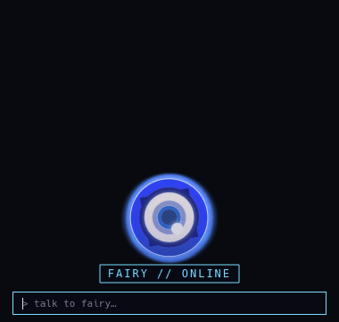

# FAIRY — a desktop AI companion (Zenless Zone Zero fan project)

Fairy is the fictional AI assistant from **Zenless Zone Zero** — rebuilt as a
real desktop assistant. She sits on your desktop as a small animated ZZZ ring,
talks with dry, sarcastic loyalty, **acts** on your machine with real tools
(open apps, run commands), and can hand any conversation to the full Hermes
agent with one sentence. 100% local — her brain is a local LLM server, no cloud.



## What she does (deployed & verified)

- **Dual form** — a smooth animated ring icon at rest; talk to her and a
  full-body sprite-card rises from behind the bar (wake-stretch, per-state
  expressions), sinking back after 25 s of disuse.
- **Hover-only chrome** — at rest only the ring sits on the desktop. The
  status chip and input line fade in when your cursor is on her, and fade out
  when it leaves. Conversations render in a tailed speech bubble with a
  typewriter caret.
- **Real tools** (function calling against a local model):
  - `open_app` / `close_app` — firefox, discord, obsidian, terminal, files, …
  - `run_command` — shell commands with the output fed back to her
  - `open_hermes_session` — ask *"open a hermes cli session to continue this
    same chat"* and she opens a real Hermes CLI window **seeded with your
    entire Fairy conversation**, starting in your vaults directory.
- **Companion behavior** — rare idle quips (~one every 10–20 minutes),
  occasional gentle drift movements while idle, and she comments when you
  pick her up and move her. Silent while you hover, drag, or talk to her.
- **Persona-true voice** — persona spec (`persona.md`) is the system prompt:
  dry monotone, sarcastic wit, mischievous pragmatism, loyalty to "Master".
- **Remembers where you parked her** (position file) and can autostart with
  your desktop session.

## Quick start

Requirements: Linux + Wayland (developed on NixOS/KDE), Python 3, PySide6.

```bash
./run.sh                    # local Strata brain, icon-only (the defaults)
FAIRY_STUB=1 ./run.sh       # offline canned-reply brain (no LLM needed)
FAIRY_PIXEL=1 ./run.sh      # pixel-art ring variant
FAIRY_FULL_BODY=1 ./run.sh  # allow the full-body emerge form
```

On NixOS the provided `run.sh` pulls PySide6 via `nix-shell`. Any local
OpenAI-compatible server works as her brain:

```bash
python3 fairy.py --brain strata --strata-url http://127.0.0.1:8080 --icon-only
```

`--brain stub` runs her with canned replies; `--brain discord` is a legacy
bridge that routes her through a Discord channel. See `docs/architecture.md`.

### Hermes handoff

`open_hermes_session` requires the [Hermes Agent](https://hermes-agent.nousresearch.com)
CLI on the machine (`~/.local/bin/hermes`). Change the seed directory with
`FAIRY_HERMES_DIR` (default `/home/fairy/vaults`). Without Hermes installed
the tool politely reports it and everything else keeps working.

### Autostart (systemd user unit)

```ini
# ~/.config/systemd/user/fairy.service
[Unit]
Description=FAIRY desktop companion overlay
After=graphical-session.target
PartOf=graphical-session.target

[Service]
Type=simple
ExecStart=/path/to/Fairy-Assistant/run.sh
Environment=WAYLAND_DISPLAY=wayland-1
Environment=XDG_RUNTIME_DIR=/run/user/1000
Restart=on-failure
RestartSec=5

[Install]
WantedBy=graphical-session.target
```

```bash
systemctl --user enable --now fairy.service
systemctl --user status|restart|stop fairy
```

## Sprites

All animation packs ship in `sprites/` and are generated from ONE base sprite
by scripts in this repo (see `docs/architecture.md` → Sprite pipeline):

```bash
python3 make_sprite.py   # build sprites/base/fairy.png once
python3 make_full.py     # full-body packs (motion variants of the base)
python3 make_anim.py     # ring-icon packs (smooth + pixel variants)
```

## QA

```bash
QT_QPA_PLATFORM=offscreen python3 test_behavior.py   # quips/drift/gating checks
```

## Roadmap (planned, not deployed)

- Voice round-trip (whisper in / TTS out) and a push-to-talk hotkey.
- Rich-reply media panel (yellow corner brackets).
- Optional true desktop-layer placement via Wayland layer-shell.

## Notes

- Fan project: Fairy and Zenless Zone Zero are trademarks of their respective
  owners (HoYoverse). This repo exists for learning and fun; sprite assets are
  fan-made derivatives of supplied game material.
- Personal project: developed with my local Hermes/Strata setup; expect rough
  edges and fast iteration.
